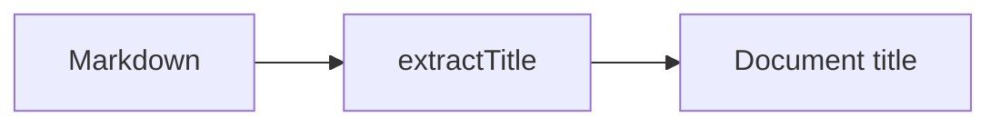

# Offline export

This walkthrough opens from a single HTML file. Diagrams, code panels, and
highlighting use embedded code and data.

## Follow a source link

Click [[src/extractDocument.ts#extractTitle]] to open the captured function.



```callstack
 title = extractTitle(markdown) [[src/extractDocument.ts#extractTitle]]
```

## Step through a diagram

```services
service Author
service Exporter [[src/export.ts#exportMarkdownFile]]
  state output = empty
start "The export is ready to begin"
step "Capture the walkthrough"
  Author -> Exporter: Markdown
  Exporter.output = review.html
```

## Read highlighted code

```ts
const title = extractTitle(markdown);
const snapshot = { title, document, files, changes };
```

Source text that resembles HTML is safe to include in a code block:

```js
const example = "</script><script>alert('this is source text')</script>";
```

## Review the captured changes

This card captures the current uncommitted changes when exported.

```changes

src/export.ts
src/export/main.tsx
src/snapshot.ts
```
